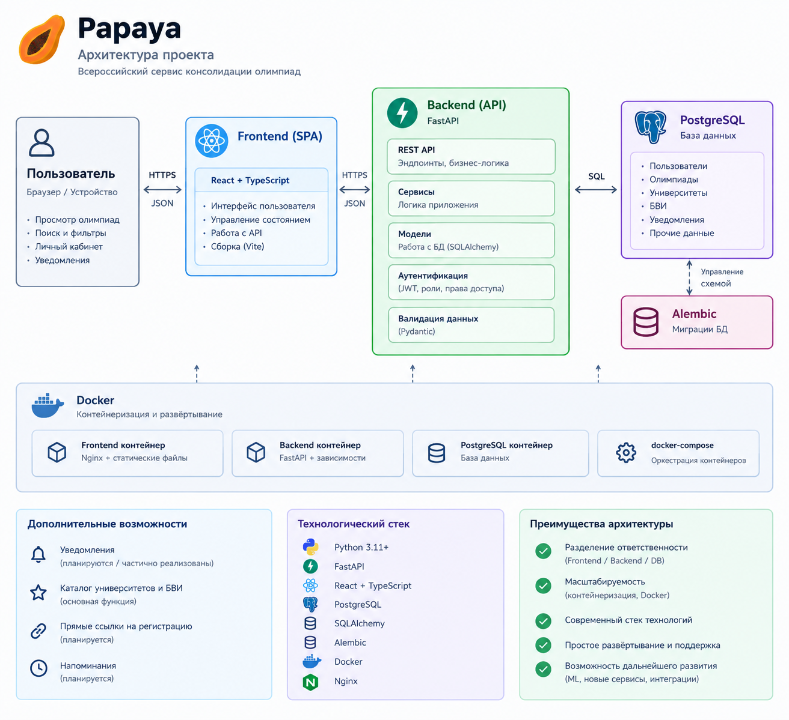

# Архитектура

[← Документация](README.md) · [К README проекта](../README.md) · [English](en/architecture.md)

- **Frontend** — SPA на vanilla JS без сборщика (hash-роутер, дизайн-система в
  `app/frontend`), работает с API по `/api/v1` и JWT-cookies. Публичные страницы
  доступны гостю.
- **Backend** — FastAPI (async): роутеры `auth`, `user`, `universities`,
  `olympiads`, `docs`, `imports`, `search`, `admin`, `health`; правила доступа — в
  `app/core/deps.py`; слой доступа к данным — в `app/database`;
  Pydantic-схемы — в `app/schemas`.
- **Импорт РСОШ** — пакет `app/rsosh`: `filetypes` → `preprocessing` → `ocr` →
  `tables` → `normalization` → `parsing` → `validation` → `matching` → `states` →
  `persist` → `processor`. Официальный перечень разбирают `list_parser` →
  `list_xlsx` → `list_plan` → `list_apply`, оркестрация — `list_processor`.
- **PostgreSQL** — основная БД, схема управляется Alembic
  (`migrations/versions`).
- **Redis** — версионный кэш профилей, брокер и бэкенд Celery.
- **Celery** — очередь `heavy` для фонового импорта документов.
- **Tesseract OCR + OpenCV + pdfplumber + pypdfium2 + openpyxl** — распознавание
  и реконструкция таблиц документов РСОШ.
- **Docker Compose** — сервисы `postgres`, `redis`, `web`, `celery`, `pgadmin` и
  профиль `testing` для тестов.

См. также: [стек технологий](tech-stack.md) ·
[импорт документов РСОШ](rsosh-import.md) · [запуск и настройка](getting-started.md).
