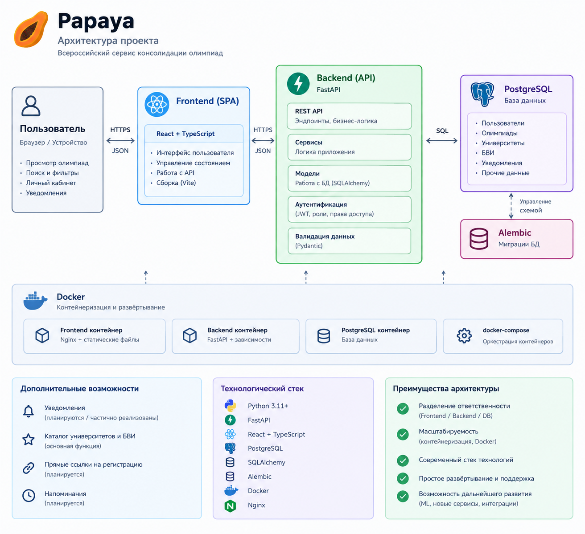

# Architecture

[← Documentation](README.md) · [Project README](../../English.md) · [Русская версия](../architecture.md)

- **Frontend** — a vanilla JS SPA without a bundler (hash router, design system
  in `app/frontend`). It talks to the API under `/api/v1` and uses JWT cookies.
  Public pages are available to guests.
- **Backend** — FastAPI (async): routers `auth`, `user`, `universities`,
  `olympiads`, `docs`, `imports`, `search`, `admin`, `health`; access rules live
  in `app/core/deps.py`; the data-access layer is in `app/database`; Pydantic
  schemas are in `app/schemas`.
- **RSOSH import** — the `app/rsosh` package: `filetypes` → `preprocessing` →
  `ocr` → `tables` → `normalization` → `parsing` → `validation` → `matching` →
  `states` → `persist` → `processor`. The official list is handled by
  `list_parser` → `list_xlsx` → `list_plan` → `list_apply`, orchestrated by
  `list_processor`.
- **PostgreSQL** — the primary database; the schema is managed by Alembic
  (`migrations/versions`).
- **Redis** — versioned profile cache, Celery broker and result backend.
- **Celery** — the `heavy` queue for background document imports.
- **Tesseract OCR + OpenCV + pdfplumber + pypdfium2 + openpyxl** — recognition
  and table reconstruction for RSOSH documents.
- **Docker Compose** — services `postgres`, `redis`, `web`, `celery`, `pgadmin`
  and a `testing` profile for tests.

See also: [technology stack](tech-stack.md) ·
[RSOSH document import](rsosh-import.md) · [getting started](getting-started.md).
